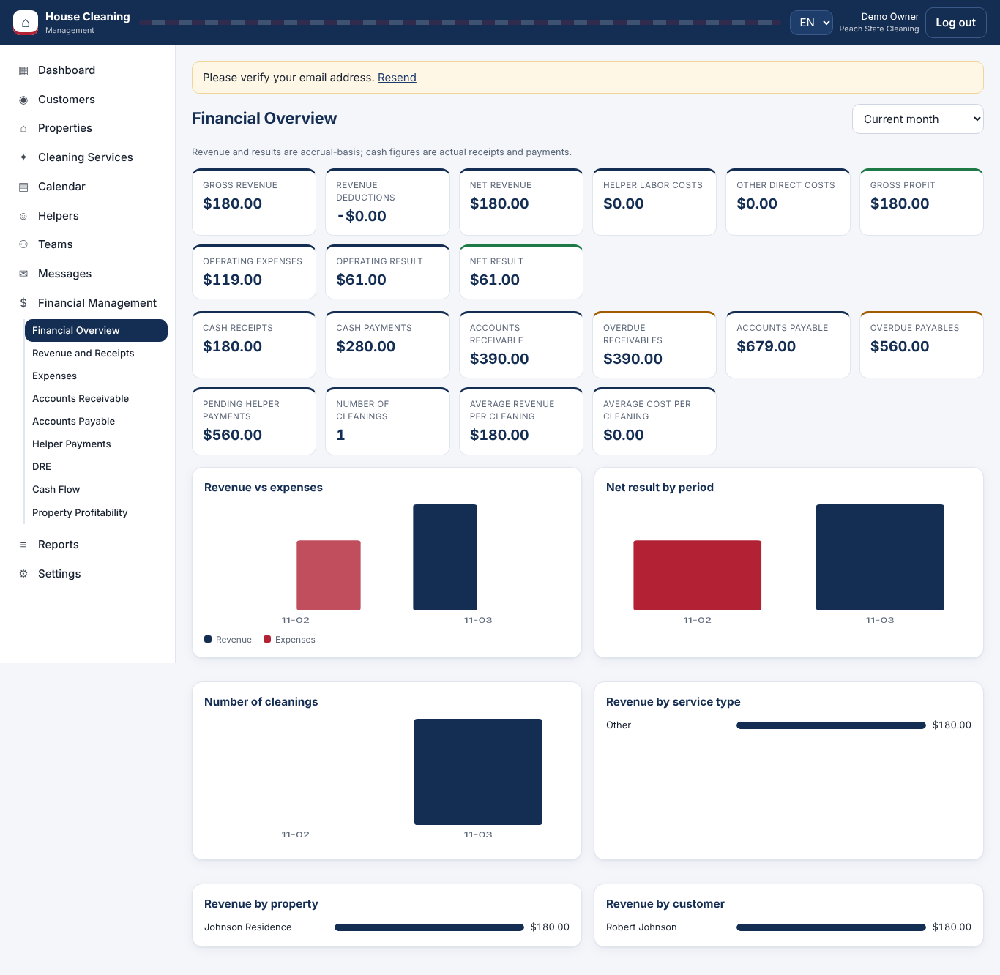

# House Cleaning Management

A multi-tenant SaaS MVP for residential cleaning companies in the United States: customers and multiple residences, negotiated prices, recurring schedules, helper assignments and payments, receivables, payables, DRE (income statement), cash flow, property profitability, private 24-hour messaging, and reports. English (default), Portuguese, and Spanish.

**Stack:** React + TypeScript (Vite) · Cloudflare Workers (modular monolith, no framework) · D1 (SQLite) · R2 (photos, attachments) · Durable Objects (real-time chat) · Cron Triggers · optional Workers AI, Turnstile, WhatsApp Cloud API.
**Status:** functional MVP, tested locally on the Workers runtime with D1. **Not deployed** (no Cloudflare credentials were provided). See [docs/STATUS.md](docs/STATUS.md).



## Windows quick start (PowerShell)

Requirements: **Node.js 22.5 or newer** (22 LTS recommended; tests use the built-in `node:sqlite`), npm 10+, Git.

```powershell
git clone https://github.com/corretoresdabahiacom-create/House-Cleaning.git
cd House-Cleaning
git checkout develop
npm install

# 1. Local secrets (never commit .dev.vars)
$key = [Convert]::ToBase64String((1..32 | ForEach-Object { Get-Random -Maximum 256 }) -as [byte[]])
"ENCRYPTION_KEY=$key`nAPP_ENV=development" | Out-File -Encoding ascii .dev.vars

# 2. Local database (D1 emulated by Wrangler, stored in .wrangler/)
npm run db:migrate:local

# 3. Build the UI and run API + UI together on http://127.0.0.1:8787
npm run build
npx wrangler dev --port 8787
```

For UI hot reload, run `npx wrangler dev --port 8787` in one terminal and `npm run dev:web` in another, then open http://localhost:5173 (Vite proxies `/api` to the Worker).

macOS/Linux: identical, except create `.dev.vars` with `printf "ENCRYPTION_KEY=$(openssl rand -base64 32)\nAPP_ENV=development\n" > .dev.vars`.

In development (`APP_ENV=development`) email delivery is not configured: verification and password-reset tokens are returned in the API response and logged in the browser console, so the flows can be tested. Use `#/?verify=TOKEN` or `#/?reset=TOKEN`.

## Commands

| Command | What it does |
|---|---|
| `npm test` | Runs the automated suite (45 tests) against the real API and the real migrations on in-memory SQLite |
| `npm run test:e2e` | Browser tests (Playwright + Chromium) against the real Worker on workerd; first run: `npm i -D playwright; npx playwright install chromium` |
| `npm run typecheck` | TypeScript strict-null check of worker, web, and tests |
| `npm run build` | Builds the React app into `dist/` (served by the Worker as static assets) |
| `npm run db:migrate:local` | Applies `migrations/` to the local D1 database |
| `npx wrangler dev` | Runs the Worker locally on the workerd runtime |
| `npx wrangler dev --test-scheduled` then `curl "http://127.0.0.1:8787/__scheduled"` | Runs the cron jobs locally |

## Project structure

```
migrations/0001_init.sql     D1 schema (2 migrations), FKs, CHECKs, UNIQUE dedupe keys, indexes
worker/src/index.ts          fetch + scheduled entry points, CSRF check, error handling, security headers
worker/src/lib/core.ts       router, validation, integer-cents money helpers
worker/src/lib/security.ts   PBKDF2 passwords, sessions, RBAC, rate limiting, AES-GCM, audit
worker/src/lib/recurrence.ts pure recurrence engine (weekly, biweekly, monthly clamp, pauses, holidays…)
worker/src/modules/          auth · crm (customers, properties, services, helpers, teams) · schedule · finance · messages · reports/admin
web/src/                     React app: i18n.ts (EN/PT/ES), ui.tsx (components), pages/*
tests/                       harness (D1 adapter over node:sqlite) + unit and API tests
docs/                        architecture, methodology, audit, deployment, legal drafts, screenshots
```

## Documentation

- [Architecture, data model, API and screen map](docs/ARCHITECTURE.md)
- [Financial methodology: DRE, cash flow, profitability, reconciliation](docs/FINANCIAL_METHODOLOGY.md)
- [Test execution report](docs/TEST_REPORT.md) · [Security audit](docs/SECURITY_AUDIT.md)
- [Deployment and cost estimate](docs/DEPLOYMENT.md) · [Key rotation](docs/KEY_ROTATION.md)
- [Status and known limitations](docs/STATUS.md)
- [Legal drafts (require attorney review)](docs/legal/)

> The financial module is a management tool, not a substitute for a qualified US accountant, CPA, or tax professional. This software is not a payroll provider, staffing agency, or employer of record.
